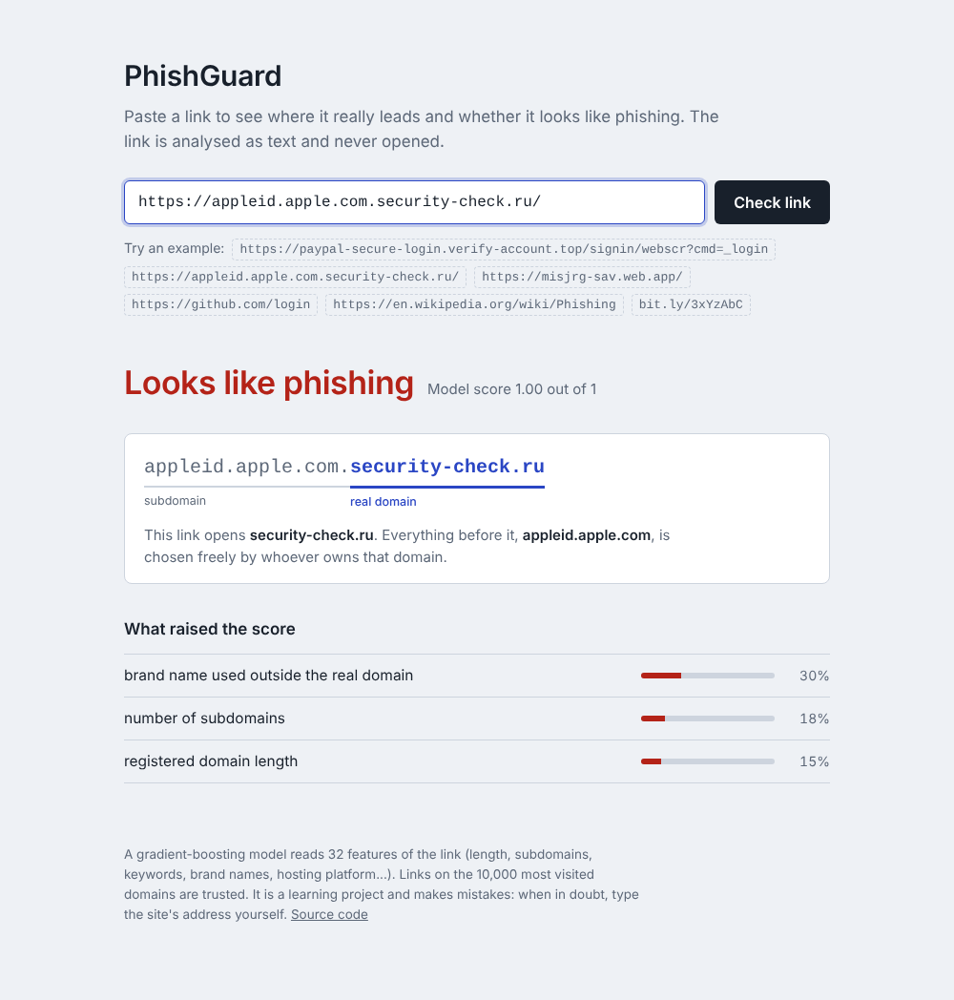
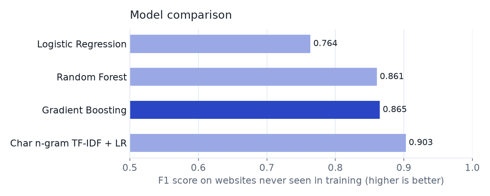
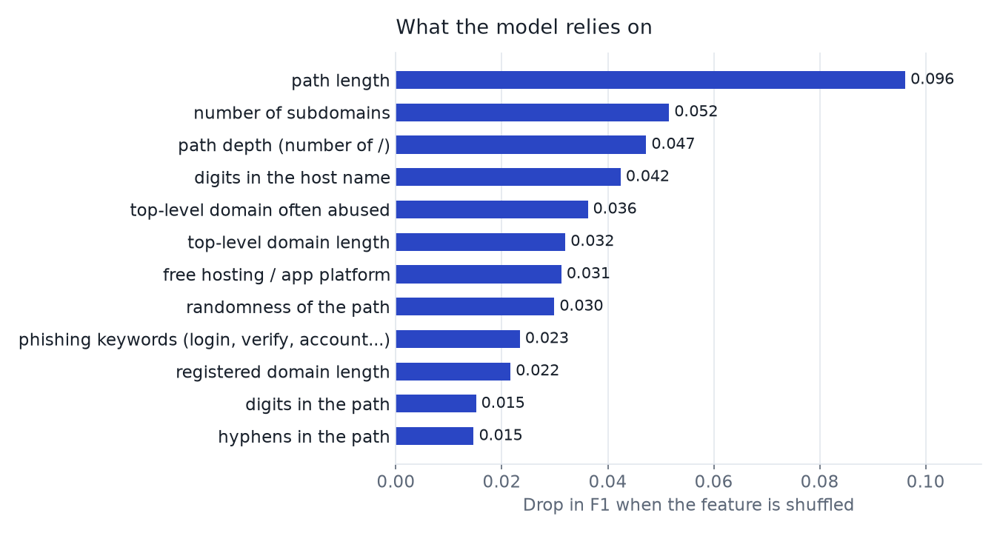

# PhishGuard

[](https://github.com/AlawiAhmedDev/phishguard/actions/workflows/ci.yml)


**A machine-learning phishing URL detector that explains each decision and never visits the link.**

*[Version française](README.fr.md)*

Paste a link: PhishGuard shows which domain it really opens, scores it with a gradient-boosting model trained on 200,000 URLs, and lists the features that raised the score. Because only the text of the URL is analysed, it is instant, works offline and is safe to run on live phishing links.



## Results at a glance

Evaluated on **39,857 URLs from websites the model never saw during training** (split by host):

| | Accuracy | Precision | Recall | F1 | ROC AUC | False positive rate |
|---|---|---|---|---|---|---|
| Model (gradient boosting) | 0.872 | 0.908 | 0.826 | 0.865 | 0.931 | 8.3 % |
| Full system (model + domain reputation) | 0.872 | 0.915 | 0.818 | 0.864 | — | 7.5 % |

On a separate benchmark of **50 modern legitimate URLs** (Google, PayPal, GitHub, Moroccan banks and universities...), the model alone wrongly flags 29, mostly login pages. The full system flags 3. Why that gap exists, and why the reputation layer is there, is explained [below](#the-problem-this-project-had-to-solve).

> These numbers are lower than the 97-99 % often reported for URL classifiers. Most of those results come from random splits, where pages of the same site end up in both the training and the test set, so the model is partly recognising sites it has already seen. Here every test site is new to the model.

## How it works

```
 URL ──► normalise ──► 32 lexical features ──► gradient boosting ──► score 0..1
         (drop scheme,   (length, subdomains,                         │
          www., case)     keywords, brand,                            ▼
                          hosting, entropy...)          popular domain? ──yes──► safe
                                                        shortener?      ──yes──► suspicious
                                                        otherwise ─────────────► model verdict + reasons
```

1. **Normalisation.** The scheme (`http/https`) and `www.` are removed. In the public datasets, legitimate URLs carry no scheme while recent phishing URLs nearly always do, so a model that saw the scheme would learn the dataset instead of phishing.
2. **Features.** 32 features computed from the string only: lengths, number of subdomains, digits and hyphens, path randomness (entropy), phishing keywords, a brand name used outside the real domain (`apple.com.security-check.ru`), IP address hosts, punycode look-alikes, abused TLDs, free hosting platforms (`web.app`, `workers.dev`...), shorteners, random tokens.
3. **Model.** `HistGradientBoostingClassifier`, chosen over three alternatives (see below).
4. **Reputation layer.** If the registered domain is among the ~10,000 most visited domains, the link is trusted, except on platforms where anyone can publish (`github.io`, `firebaseapp.com`, `sites.google.com`...). Shortened links are reported as suspicious, since their destination is hidden.
5. **Explanation.** Each feature is reset in turn to its typical value on legitimate URLs, and the drop in phishing evidence (in log-odds) is measured. The features with the largest drop are shown as reasons, with their share of the evidence.

## Model comparison



| Model | Precision | Recall | F1 | ROC AUC | Train time |
|---|---|---|---|---|---|
| Logistic regression (features) | 0.839 | 0.701 | 0.764 | 0.864 | 1 s |
| Random forest (features) | 0.900 | 0.824 | 0.861 | 0.925 | 17 s |
| **Gradient boosting (features), selected** | **0.908** | **0.826** | **0.865** | **0.931** | **12 s** |
| Character n-gram TF-IDF + logistic regression | 0.934 | 0.874 | 0.903 | 0.964 | 50 s |

The character n-gram model scores higher but works on 200,000 opaque text fragments, so it cannot say *why* a link is suspicious. Gradient boosting on named features was kept for its explanations, size (1.3 MB) and speed (a few ms per URL). Combining both is the next step on the roadmap.



## The problem this project had to solve

The first version scored F1 = 0.91 on its test set and looked finished. Then it was tested on 50 real login pages of well-known sites: **it flagged 28 of them as phishing**.

The cause was the data. The legitimate URLs in the public datasets are either old (around 2011) or homepages only, with almost no login pages. Phishing URLs are full of `login`, `signin`, `verify`. The model had learned "login page = phishing".

Three changes were made:

1. **Modern legitimate URLs with paths** were added, extracted from about 40 community-curated "awesome" lists on GitHub (documentation, blogs, articles). Ordinary modern pages now score low: Wikipedia 0.22, Stack Overflow 0.01, BBC 0.02.
2. **Source-balanced sampling and a per-host cap**, so the model cannot tell classes apart just by which dataset a URL came from, and one big site or phishing kit cannot dominate.
3. **A domain-reputation layer**, as real filters do. A login page on an unknown domain *is* worth caution; legitimate login pages live on popular domains.

The 3 legitimate URLs still flagged by the full system (`attijariwafabank.com/fr`, `binance.com/en/login`, `notion.so/login`) are on domains missing from the bundled popularity list. Running `phishguard update-reputation` replaces it with the current [Tranco](https://tranco-list.eu) ranking, which reflects sites that became popular recently.

## Quick start

```bash
git clone https://github.com/AlawiAhmedDev/phishguard.git
cd phishguard
python3 -m venv .venv && source .venv/bin/activate
pip install -e .

phishguard check https://appleid.apple.com.security-check.ru/ https://github.com/login
```

```text
PHISHING   score=1.00  https://appleid.apple.com.security-check.ru/
           - brand name used outside the real domain  (30%)
           - number of subdomains  (18%)
           - registered domain length  (15%)
SAFE       score=0.74 (popular domain)  https://github.com/login
```

### Web interface

```bash
phishguard serve            # then open http://127.0.0.1:5000
```

### Other commands

```bash
phishguard check -f urls.txt --json        # batch, JSON output
phishguard check URL --no-reputation       # model only
phishguard check URL --fail-on-phishing    # exit code 2 if phishing (scripts, CI)
phishguard update-reputation               # refresh popular domains from Tranco
phishguard train                           # download data, retrain, rewrite the report (~3 min)
```

### JSON API

```bash
curl "http://127.0.0.1:5000/api/check?url=https://misjrg-sav.web.app/"
```

```json
{
  "verdict": "phishing", "score": 0.9933, "decided_by": "model",
  "registered_domain": "web.app",
  "reasons": [{"label": "free hosting / app platform", "impact": 0.69, "...": "..."}],
  "anatomy": {"subdomain": "misjrg-sav", "registered_domain": "web.app", "path": "", "query": ""}
}
```

## Data

| Source | Used for | URLs kept |
|---|---|---|
| [Faizan Ahmad, malicious URL dataset](https://github.com/faizann24/Using-machine-learning-to-detect-malicious-URLs) | legitimate + phishing | 44,860 + 33,333 |
| [PhiUSIIL Phishing URL Dataset](https://archive.ics.uci.edu/dataset/967) (Prasad & Chandra, 2024) | legitimate + phishing | 44,860 + 33,333 |
| [Phishing.Database](https://github.com/mitchellkrogza/Phishing.Database) (active links) | phishing | 33,334 |
| Links from ~40 "awesome" lists on GitHub | modern legitimate | 10,280 |

Cleaning: normalisation, deduplication, removal of URLs labelled both ways, at most 5 URLs per host, balanced classes. Train/test split by host (`GroupShuffleSplit`), checked by an assertion in the code. Full results, including per-source recall and the benchmark URL by URL, are in [`models/metrics.json`](models/metrics.json).

## Project layout

```
phishguard/
├── phishguard/
│   ├── features.py     # URL parsing and the 32 features
│   ├── model.py        # scoring, verdict, explanations
│   ├── reputation.py   # popular-domain layer, Tranco update
│   ├── data.py         # download and cleaning of the datasets
│   ├── train.py        # model comparison, evaluation, report
│   ├── benchmarks.py   # 50 modern legitimate URLs (evaluation only)
│   ├── app.py          # Flask web interface and JSON API
│   └── cli.py          # command-line interface
├── models/             # trained model, metrics, popular domains
├── scripts/            # chart generation
├── tests/              # 29 pytest tests
└── docs/               # screenshots and charts
```

## Limitations

- **Lexical analysis only.** A phishing page on a clean-looking URL (`secure-account-center.com/`) or on a compromised legitimate site will be missed. In the test set, 175 phishing URLs were hosted on popular domains and are missed by design.
- **Recall of 82 %**: about one phishing link in five gets through. PhishGuard is a first filter, not a guarantee.
- **The popularity list is not a safety list.** Pages that anyone can create on a trusted domain (for example a Google Forms page) are trusted too.
- **Dataset age.** The legitimate data is partly old, and phishing changes quickly. Retrain regularly with `phishguard train`.

## Roadmap

- [ ] Combine the explainable model with the character n-gram model
- [ ] Browser extension that checks links on hover
- [ ] Optional enrichment: domain age (WHOIS), TLS certificate, page content
- [ ] Evaluation on a time-based split (train on older URLs, test on newer ones)

## Author

**Alawi Masfar**, MSc in Cybersecurity and Artificial Intelligence. GitHub: [@AlawiAhmedDev](https://github.com/AlawiAhmedDev)

## License

[MIT](LICENSE). The datasets keep their own licenses.
